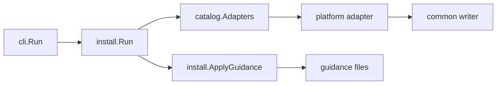

# Architecture

The module separates host knowledge from orchestration. An adapter knows one
host's file and shape; the installer knows how to run adapters and collect
results; the CLI knows how to parse arguments. No layer reaches into another's
concerns.

## Package map

| Package | Responsibility |
| --- | --- |
| `mcpinstall` | The `Spec` type that identifies one server. |
| `platform` | `Scope`, `Target`, `Capabilities`, and the `Adapter` interface. |
| `platform/catalog` | Host names, `--host` resolution, adapter statuses. |
| `platform/common` | `Options`, the JSON, JSONC and TOML writers, atomic file writes, shared result helpers. |
| `platform/<host>` | One adapter per host. |
| `install` | Request orchestration, guidance application, legacy cleanup. |
| `cli` | The parameterized command surface. |

## The adapter contract

```go
type Adapter interface {
	Name() string
	Status() AdapterStatus
	Install(target Target, opts common.Options) (created []string, warnings []string, err error)
	Remove(target Target, opts common.Options) (removed []string, warnings []string, err error)
}
```

An adapter reads and writes exactly one family of files. It returns the paths
it changed and any warnings, and it treats a dry run as a request to compute
those paths without writing. A host that needs a shape of its own still builds
the entry from the shared `Options`, so the server identity travels one way.

## Flow



`cli.Run` parses the subcommand and flags. `install.Run` resolves the scope
root, looks each host up in the catalog, and runs the adapter. The adapter
builds the entry from `Options` and hands it to a `common` writer, which owns
the merge and the file write.

## The catalog

The catalog is the single registry of hosts. `Adapters` maps a name to an
adapter, `Names` lists the concrete hosts, `Selectors` adds the `all` meta name
for help text, and `ResolveList` expands a comma-separated `--host` value.
Adding a host means adding one adapter package and one entry here; nothing else
learns about it.

`Statuses` reports each adapter's [capabilities](glossary.md#capabilities): its
configuration format, its server table key, and whether it has a
machine-readable MCP configuration. The `hosts` command prints that table.

## The common writers

Every configuration merge funnels through `platform/common`:

- `UpsertMCPServer*` and `RemoveMCPServer*` write the `mcpServers` style JSON
  hosts, with variants that adopt or leave alone a legacy key.
- `UpsertTOMLMCPServer` and `RemoveTOMLMCPServer` do the same for TOML.
- `writeFile` writes through a temporary file and a rename, and skips a file
  that already holds the exact bytes.

The JSON reader normalises JSONC first, so a commented host file merges instead
of failing. The same three outcomes recur across all of them: a valid merge, an
unchanged file, or a preserved file with a warning.

## Design rules

- Host knowledge stays in the host package; the installer holds none.
- `platform/common` imports no host, so adapters depend on it freely.
- One registry decides which hosts exist.
- Writes are atomic and idempotent: a repeated install is quiet.
- A file the tool cannot parse is preserved and reported, never clobbered.
- The layers use current Go idioms, including `strings.SplitSeq`, the `max`
  builtin, and `slices.Sort`.
