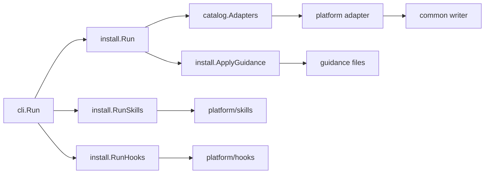

# Architecture

The module separates host knowledge from orchestration. An adapter knows one
host's file and shape; the installer knows how to run adapters and collect
results; the CLI knows how to parse arguments. No layer reaches into another's
concerns.

## Package map

| Package | Responsibility |
| --- | --- |
| `mcpinstall` | The `Spec` type that identifies one server. |
| `platform` | `Scope`, `Target`, `Capabilities`, the `Adapter` interface, and `ScopeSupport`. |
| `platform/catalog` | Host names, `--host` resolution, adapter statuses. |
| `platform/common` | `Options`, transport inference, the JSON, JSONC and TOML writers, nested-map writers, atomic file writes, shared result helpers. |
| `platform/<host>` | One adapter for each of the original six hosts. |
| `platform/hosts` | The table-driven host matrix: one descriptor per additional host, plus shared path and entry builders. |
| `platform/skills` | Agent Skills roots, marker injection, managed install and removal. |
| `platform/hooks` | Portable lifecycle events, host descriptors, and the JSON, TOML, and exec-form hook writers. |
| `install` | Request orchestration for MCP, skills and hooks, guidance application, legacy cleanup. |
| `cli` | The parameterized command surface. |

## The adapter contract

```go
type Adapter interface {
	Name() string
	Status() AdapterStatus
	Install(target Target, opts common.Options) (created []string, warnings []string, err error)
	Remove(target Target, opts common.Options) (removed []string, warnings []string, err error)
}
```

An adapter reads and writes exactly one family of files. It returns the paths
it changed and any warnings, and it treats a dry run as a request to compute
those paths without writing. A host that needs a shape of its own still builds
the entry from the shared `Options`, so the server identity travels one way.

`Options` carries both transports: `Transport` selects `stdio` or `http`, `URL`
and `Headers` describe a remote endpoint, and `TokenEnvVar` names a bearer
variable for hosts that support indirection. An empty transport infers `http`
from a non-empty URL and `stdio` otherwise.

An adapter may also implement `platform.ScopeSupport`:

```go
type ScopeSupport interface {
	SupportsScope(scope Scope) bool
}
```

`install.Run` consults it before invoking the adapter, so a global-only host
selected through `all` is skipped with a warning instead of failing the run.

## Flow



`cli.Run` parses the subcommand and flags. `install.Run` resolves the scope
root, looks each host up in the catalog, and runs the adapter. The adapter
builds the entry from `Options` and hands it to a `common` writer, which owns
the merge and the file write.

## The catalog

The catalog is the single registry of hosts. `Adapters` maps a name to an
adapter, `Names` lists the supported concrete hosts, `Selectors` adds the `all`
meta name for help text, and `ResolveList` expands a comma-separated `--host`
value and folds the common aliases onto catalog names. Adding a host means
adding one adapter package or one descriptor and one registry entry; nothing
else learns about it.

A host with no writer (DeepSeek Harness, Pi) is still in `Adapters` so an
explicit selection can return its guidance, but `Names` omits it so `all` never
reports a host that has no file to write.

`Statuses` reports each adapter's [capabilities](glossary.md#capabilities): its
configuration format, its server table key, and whether it has a
machine-readable MCP configuration. The `hosts` command prints that table.

## The common writers

Every configuration merge funnels through `platform/common`:

- `UpsertMCPServer*` and `RemoveMCPServer*` write the `mcpServers` style JSON
  hosts, with variants that adopt or leave alone a legacy key.
- `UpsertMCPServerAtPath` and `RemoveMCPServerAtPath` write a nested map such as
  OpenClaw's `mcp.servers`, pruning the containers a removal empties.
- `UpsertTOMLMCPServer` and `RemoveTOMLMCPServer` do the same for TOML.
- `writeFile` writes through a temporary file and a rename, and skips a file
  that already holds the exact bytes.

The JSON reader normalises JSONC first, so a commented host file merges instead
of failing. The same three outcomes recur across all of them: a valid merge, an
unchanged file, or a preserved file with a warning.

## The extensions

Skills and hooks sit beside the MCP path rather than inside it:

- `platform/skills` owns a small descriptor table of skills roots and writes a
  marked `SKILL.md`. It reads an existing file only to decide whether the
  marker permits replacement; it never claims supporting files it did not
  write.
- `platform/hooks` owns the portable event list, one descriptor per host, and
  one writer per configuration shape. A descriptor is data: path resolver,
  shape, event map, and the few flags a shape needs. The writers preserve
  unrelated entries and identify this tool's entries by marker or generated
  id.
- `install.RunSkills` and `install.RunHooks` mirror `install.Run`: resolve the
  scope root, skip hosts that do not support the scope, collect one result per
  host, and return the results even when one host fails.

Adding a skills host is one descriptor. Adding a hooks host is one descriptor
when it uses an existing shape, or one writer when it does not.

## Design rules

- Host knowledge stays in the host package or descriptor; the installer holds
  none.
- `platform/common` imports no host, so adapters depend on it freely.
- One registry decides which hosts exist.
- Writes are atomic and idempotent: a repeated install is quiet.
- A file the tool cannot parse is preserved and reported, never clobbered.
- The layers use current Go idioms, including `strings.SplitSeq`, the `max`
  builtin, and `slices.Sort`.
